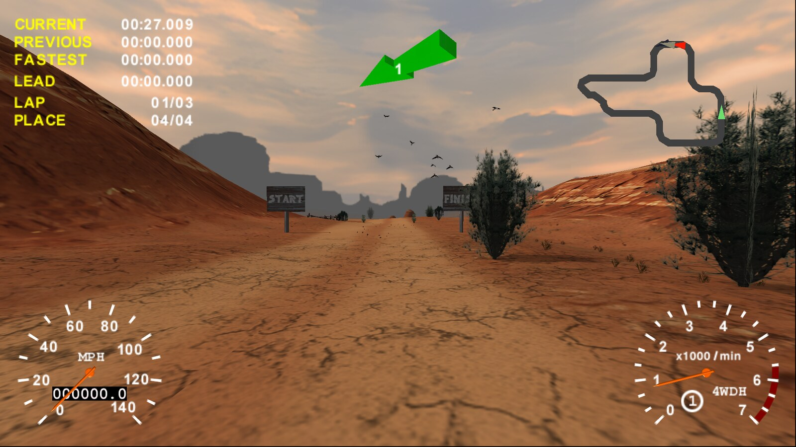
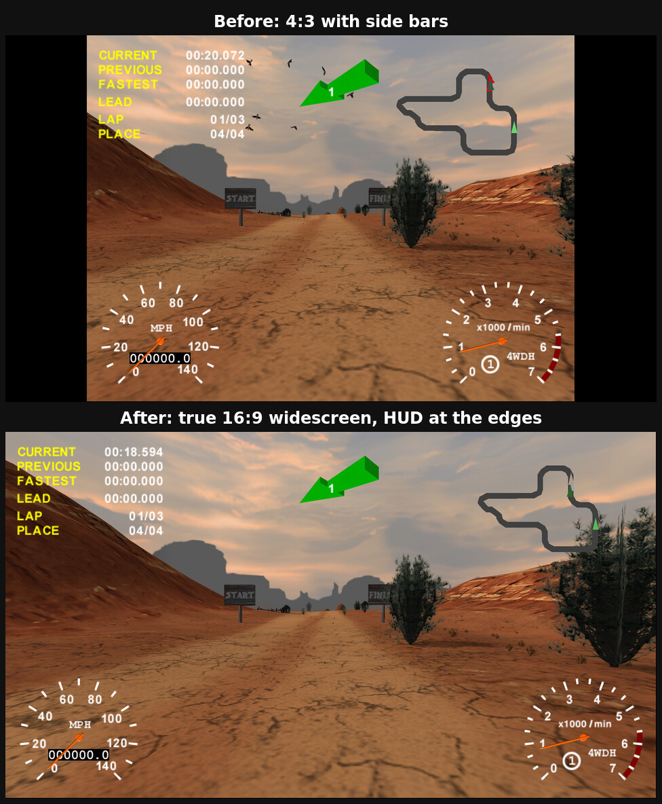
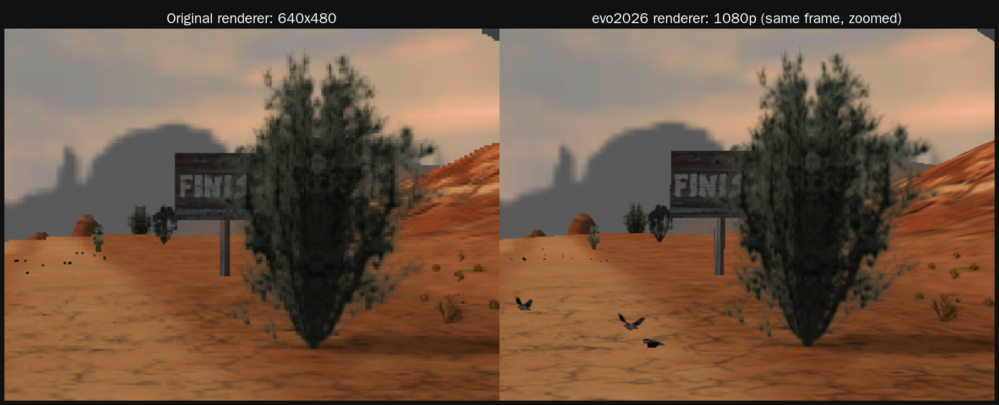
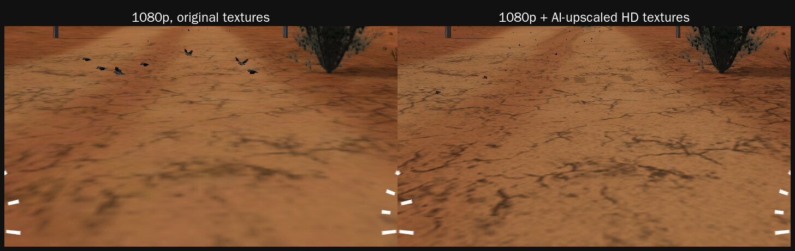
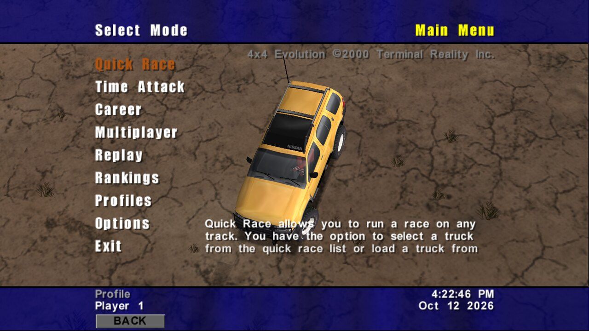
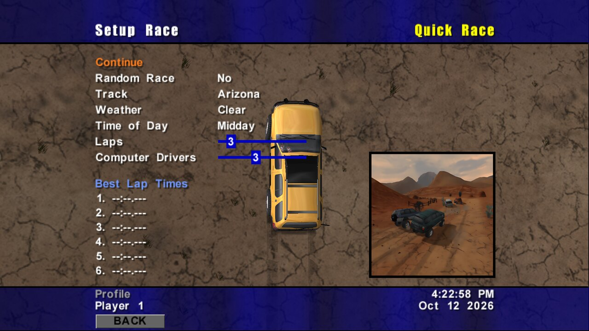
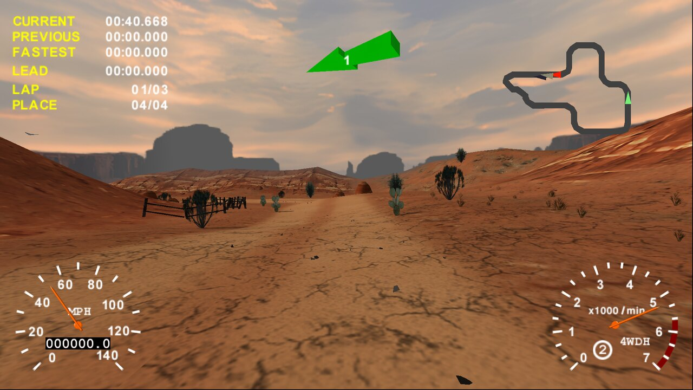
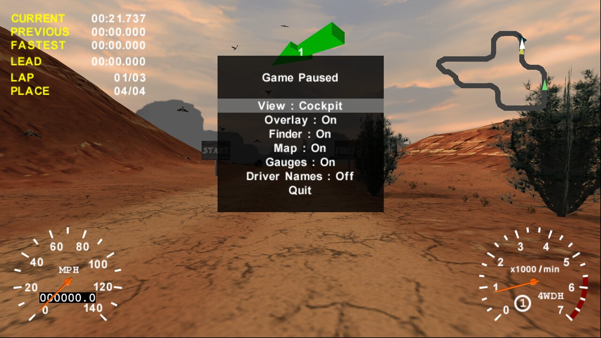

# 4x4 Evolution 2026 (evo2026)



A drop-in Direct3D 9 renderer for **4x4 Evolution Build 57** (Terminal Reality, 2000) that runs the game on modern Windows:

- native-resolution output (1080p, 1440p, 4K) in a borderless window
- true widescreen (Hor+), with the race HUD moved to the screen edges
- 16× anisotropic filtering, vsync
- HD texture replacement, with tools to export and AI-upscale the game's textures

Built on the open-source [4x4e](https://github.com/americusmaximus/4x4e) Direct3D 9 renderer (MIT).

## Screenshots

All screenshots are at 1920×1080.

### Widescreen

The extra width shows more of the track at the sides. Nothing is stretched, and the HUD moves out to the edges.



### Native resolution

The same frame as the original 640×480 renderer draws it, and as evo2026 draws it at 1080p (zoomed in).



### HD textures

The original textures next to the AI-upscaled HD pack.



### In game

<table>
  <tr>
    <td></td>
    <td></td>
  </tr>
  <tr>
    <td align="center">Main menu</td>
    <td align="center">Quick Race setup</td>
  </tr>
  <tr>
    <td></td>
    <td></td>
  </tr>
  <tr>
    <td align="center">On the track</td>
    <td align="center">Pause menu</td>
  </tr>
</table>

## Layout

| Path | What it is |
|---|---|
| `renderer/` | Renderer source (C++20, MinGW-w64 i686) |
| `tools/` | `pod_textures.py` (export textures from the PODs), `upscale_textures.py` (Real-ESRGAN), `traceproxy/` (renderer call tracer) |
| `dist/` | User kit: README, `install.ps1` / `uninstall.ps1` |
| `docs/screenshots/` | The screenshots on this page |
| `installer/` | Inno Setup script and artwork for the all-in-one installer (game files not included) |

Full documentation, settings and the texture workflow: [`dist/README.md`](dist/README.md).

## Build

```
make            # needs i686-w64-mingw32-g++ (Linux/WSL: apt install g++-mingw-w64-i686)
```

Output: `build/evo2026.dll`, installed into the game folder as `TRIDX7.DLL`.

## Releases

Each release carries the built DLL kit, the HD texture packs and the all-in-one installer (`4x4Evolution2026-Setup.exe` plus its `-N.bin` slices: download them all into one folder, then run the exe).

The installer contains game files from a personal copy of the game, so this repository must stay **private**.
